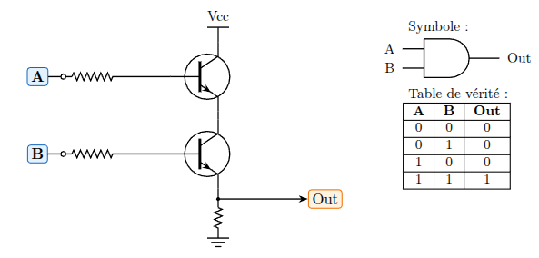
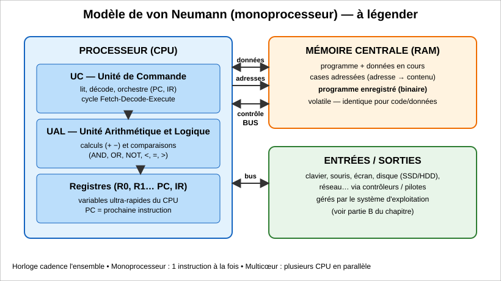
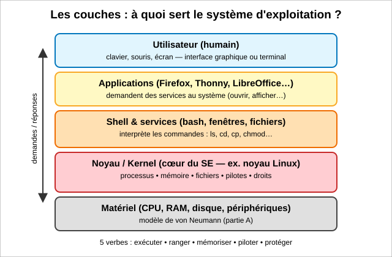
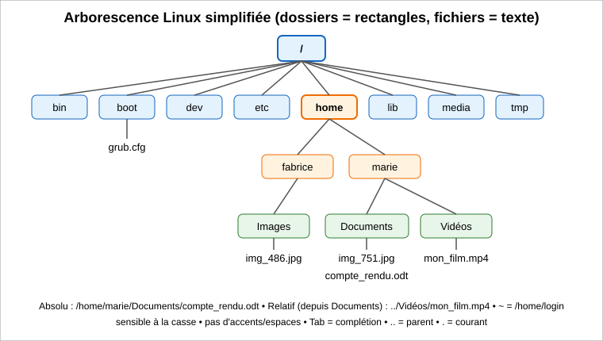

> **Fil conducteur —** Quand je lance mon programme Python, que fait vraiment la machine ?

## Capacités à maîtriser

À la fin de ce chapitre, je dois être capable de :

- distinguer les rôles du processeur, de la mémoire, des bus et des entrées-sorties ;
- dérouler l’exécution d’une séquence simple d’instructions en langage machine ou en assembleur ;
- identifier les fonctions d’un système d’exploitation ;
- utiliser les commandes de base en ligne de commande ;
- gérer les droits et permissions d’accès aux fichiers.

## Histoire express : d’où vient l’ordinateur ?

| Date | Événement | Personnages | Importance |
|---|---|---|---|
| 1936 | Machine universelle de Turing | Alan Turing | Modèle théorique d’une machine capable d’exécuter des algorithmes. |
| 1945 | ENIAC | John Mauchly et J. Presper Eckert | Ordinateur électronique programmé par câblage, construit notamment pour les calculs balistiques. |
| 1945 | Rapport sur l’EDVAC et programme enregistré | John von Neumann | Le programme est stocké en mémoire comme les données : il n’est plus nécessaire de recâbler la machine pour chaque programme. |
| 1947 | Transistor | John Bardeen, Walter Brattain et William Shockley (Bell Labs) | Composant plus petit, plus fiable et moins énergivore que le tube à vide. |
| 1958 | Circuit intégré | Jack Kilby et Robert Noyce | Plusieurs composants sont réunis sur une même puce ; cette évolution rend possible la miniaturisation à grande échelle. |

Avant le programme enregistré, programmer certaines machines consistait à les **câbler**. Dans l’architecture de von Neumann, le programme et les données sont **stockés en mémoire** sous forme binaire. Une même machine peut ainsi exécuter des programmes différents.

## Du transistor aux circuits combinatoires

Transistor = **interrupteur commandé** ; états : **ouvert/bloqué (0)** et **fermé/passant (1)**. En combinant des transistors, on construit des portes logiques.

Deux transistors montés en série illustrent la porte AND : le courant passe dans l’ensemble lorsque les deux entrées sont actives. La sortie vaut donc 1 uniquement pour $A=1$ et $B=1$.

{fig-alt="Schéma d’une porte AND réalisée avec deux transistors en série."}

### Portes logiques

<style>
.logic-gates-table {
    display: table;
    width: 100%;
    min-width: 720px;
    table-layout: fixed;
    margin: 0 auto;
    border-collapse: collapse;
}
.logic-gates-table th,
.logic-gates-table td {
    border: 1px solid currentColor;
    padding: 0.3rem 0.45rem;
    vertical-align: middle;
}
.logic-gates-table th {
    text-align: center;
}
.logic-gates-table td:first-child {
    text-align: center;
}
.logic-gates-table .gate-symbol {
    display: block;
    width: 140px;
    max-width: 100%;
    height: auto;
    margin: 0 auto;
}
.logic-truth-table {
    display: table;
    width: auto;
    margin: 0 auto;
    border-collapse: collapse;
    text-align: center;
}
.logic-truth-table th,
.logic-truth-table td {
    min-width: 1.4em;
    padding: 0.08rem 0.3rem;
    border: 1px solid currentColor;
}
</style>

<table class="logic-gates-table">
<colgroup>
<col style="width: 9%">
<col style="width: 24%">
<col style="width: 22%">
<col style="width: 45%">
</colgroup>
<thead>
<tr>
<th scope="col">Porte</th>
<th scope="col">Symbole normalisé</th>
<th scope="col">Table de vérité</th>
<th scope="col">Ce qu’elle fait</th>
</tr>
</thead>
<tbody>
<tr>
<td>NOT</td>
<td>
<svg class="gate-symbol" viewBox="0 0 140 75" role="img" aria-label="Porte NOT : entrée A, triangle inverseur avec cercle, sortie Y">
<text x="5" y="41" font-size="15">A</text>
<path d="M25 37.5 H42 M42 18 L42 57 Z M42 18 L77 37.5 L42 57" fill="none" stroke="currentColor" stroke-width="2"/>
<circle cx="83" cy="37.5" r="5.5" fill="white" stroke="currentColor" stroke-width="2"/>
<path d="M88.5 37.5 H112" fill="none" stroke="currentColor" stroke-width="2"/>
<text x="119" y="42" font-size="15">Y</text>
</svg>
</td>
<td>
<table class="logic-truth-table" aria-label="Table de vérité de NOT">
<thead><tr><th>A</th><th>Y</th></tr></thead>
<tbody><tr><td>0</td><td>1</td></tr><tr><td>1</td><td>0</td></tr></tbody>
</table>
</td>
<td>inverse : <strong>Y = non A</strong></td>
</tr>
<tr>
<td>AND</td>
<td>
<svg class="gate-symbol" viewBox="0 0 140 75" role="img" aria-label="Porte AND à deux entrées A et B, sortie Y">
<text x="5" y="29" font-size="15">A</text><text x="5" y="59" font-size="15">B</text>
<path d="M22 25 H42 M22 55 H42 M42 12 H70 A25 25 0 0 1 70 62 H42 Z M95 37 H116" fill="none" stroke="currentColor" stroke-width="2"/>
<text x="122" y="42" font-size="15">Y</text>
</svg>
</td>
<td>
<table class="logic-truth-table" aria-label="Table de vérité de AND">
<thead><tr><th>A</th><th>B</th><th>Y</th></tr></thead>
<tbody><tr><td>0</td><td>0</td><td><strong>0</strong></td></tr><tr><td>0</td><td>1</td><td><strong>0</strong></td></tr><tr><td>1</td><td>0</td><td><strong>0</strong></td></tr><tr><td>1</td><td>1</td><td>1</td></tr></tbody>
</table>
</td>
<td>Y=1 ssi A=1 ET B=1</td>
</tr>
<tr>
<td>OR</td>
<td>
<svg class="gate-symbol" viewBox="0 0 140 75" role="img" aria-label="Porte OR à deux entrées A et B, sortie Y">
<text x="5" y="29" font-size="15">A</text><text x="5" y="59" font-size="15">B</text>
<path d="M22 25 H44 M22 55 H44 M44 12 Q60 37.5 44 62 Q80 62 100 37.5 Q80 13 44 12 M100 37.5 H116" fill="none" stroke="currentColor" stroke-width="2"/>
<text x="122" y="42" font-size="15">Y</text>
</svg>
</td>
<td>
<table class="logic-truth-table" aria-label="Table de vérité de OR">
<thead><tr><th>A</th><th>B</th><th>Y</th></tr></thead>
<tbody><tr><td>0</td><td>0</td><td>0</td></tr><tr><td>0</td><td>1</td><td>1</td></tr><tr><td>1</td><td>0</td><td>1</td></tr><tr><td>1</td><td>1</td><td>1</td></tr></tbody>
</table>
</td>
<td>Y=1 dès que <strong>au moins une entrée = 1</strong></td>
</tr>
<tr>
<td>NAND</td>
<td>
<svg class="gate-symbol" viewBox="0 0 140 75" role="img" aria-label="Porte NAND à deux entrées A et B, sortie inversée Y">
<text x="5" y="29" font-size="15">A</text><text x="5" y="59" font-size="15">B</text>
<path d="M22 25 H42 M22 55 H42 M42 12 H70 A25 25 0 0 1 70 62 H42 Z M95 37 H116" fill="none" stroke="currentColor" stroke-width="2"/>
<circle cx="100" cy="37" r="5.5" fill="white" stroke="currentColor" stroke-width="2"/>
<path d="M105.5 37 H116" fill="none" stroke="currentColor" stroke-width="2"/>
<text x="122" y="42" font-size="15">Y</text>
</svg>
</td>
<td>
<table class="logic-truth-table" aria-label="Table de vérité de NAND">
<thead><tr><th>A</th><th>B</th><th>Y</th></tr></thead>
<tbody><tr><td>0</td><td>0</td><td>1</td></tr><tr><td>0</td><td>1</td><td>1</td></tr><tr><td>1</td><td>0</td><td>1</td></tr><tr><td>1</td><td>1</td><td>0</td></tr></tbody>
</table>
</td>
<td>inverse de <strong>AND</strong></td>
</tr>
<tr>
<td>XOR</td>
<td>
<svg class="gate-symbol" viewBox="0 0 140 75" role="img" aria-label="Porte XOR à deux entrées A et B, sortie Y">
<text x="5" y="29" font-size="15">A</text><text x="5" y="59" font-size="15">B</text>
<path d="M22 25 H44 M22 55 H44 M36 9 Q52 37.5 36 66 M44 12 Q60 37.5 44 62 Q80 62 100 37.5 Q80 13 44 12 M100 37.5 H116" fill="none" stroke="currentColor" stroke-width="2"/>
<text x="122" y="42" font-size="15">Y</text>
</svg>
</td>
<td>
<table class="logic-truth-table" aria-label="Table de vérité de XOR">
<thead><tr><th>A</th><th>B</th><th>Y</th></tr></thead>
<tbody><tr><td>0</td><td>0</td><td>0</td></tr><tr><td>0</td><td>1</td><td>1</td></tr><tr><td>1</td><td>0</td><td>1</td></tr><tr><td>1</td><td>1</td><td>0</td></tr></tbody>
</table>
</td>
<td>Y=1 si entrées <strong>différentes</strong></td>
</tr>
</tbody>
</table>

Un **circuit combinatoire** est un circuit dont les sorties ne dépendent que des entrées présentes à cet instant. Il n’a pas de mémoire et réalise une fonction booléenne.

### Exemple : additionneur 1 bit

Pour additionner deux bits $A$ et $B$, on obtient :

- la somme $S = A \text{ XOR } B$ ;
- la retenue $R = A \text{ AND } B$.

| $A$ | $B$ | Retenue $R$ | Somme $S$ | Résultat |
|---:|---:|---:|---:|---:|
| 0 | 0 | 0 | 0 | $0+0=0$ |
| 0 | 1 | 0 | 1 | $0+1=1$ |
| 1 | 0 | 0 | 1 | $1+0=1$ |
| 1 | 1 | 1 | 0 | $1+1=10_2$ |

Les opérateurs `and`, `or` et `not` de Python expriment les mêmes fonctions booléennes ; dans un processeur, celles-ci sont réalisées par des circuits électroniques.

## Le modèle de von Neumann

Le modèle de von Neumann décrit une machine organisée autour de blocs fonctionnels reliés entre eux. Deux idées sont fondamentales :

1. La machine comporte un processeur, une mémoire, des entrées-sorties et des bus qui permettent les échanges.
2. Le **programme enregistré** : les instructions du programme et les données sont codées en binaire et stockées dans la mémoire.

{fig-alt="Schéma du modèle de von Neumann, avec UC, UAL, registres, RAM et entrées-sorties."}

### Rôle des constituants

- **UC — Unité de commande** : lit l’instruction à exécuter, la décode et commande les opérations du processeur.
- **UAL — Unité arithmétique et logique** : effectue les calculs arithmétiques (addition, soustraction…) et les opérations logiques ou comparaisons.
- **Registres** : petites mémoires très rapides situées dans le processeur. Les registres généraux (`R0`, `R1`…) contiennent des valeurs utiles aux calculs. Le **PC** (*Program Counter*) contient l’adresse de la prochaine instruction ; l’**IR** (*Instruction Register*) contient l’instruction en cours.
- **Mémoire centrale (RAM)** : conserve les programmes et les données utilisés pendant leur exécution. Elle est organisée en cases adressables.
- **Bus** : voies de communication entre les composants. Le bus de données transporte les valeurs ; le bus d’adresses indique la case concernée ; le bus de contrôle transporte les commandes de lecture et d’écriture.
- **Entrées-sorties (E/S)** : permettent les échanges avec l’extérieur — clavier, souris, écran, disque, réseau — par l’intermédiaire de contrôleurs.

### Cycle d’exécution d’une instruction

Le processeur répète un cycle appelé **Fetch – Decode – Execute** :

1. **Fetch (recherche)** : lire en mémoire l’instruction désignée par le PC. Le processeur prépare ensuite l’adresse de l’instruction suivante.
2. **Decode (décodage)** : l’UC identifie l’opération et les opérandes concernés.
3. **Execute (exécution)** : le processeur effectue l’opération demandée, éventuellement avec l’UAL ou la mémoire, puis recommence le cycle.

Une instruction de saut peut modifier le PC : l’instruction suivante n’est alors pas nécessairement celle qui suit immédiatement dans le programme.

### Monoprocesseur, multicœur et limite du modèle

Un **monoprocesseur** possède un seul processeur. Un **processeur multicœur** contient plusieurs cœurs capables de traiter plusieurs tâches en parallèle, lorsque celles-ci peuvent être parallélisées. Les cartes graphiques (GPU) disposent souvent d’un grand nombre de cœurs spécialisés.

Le **goulot d’étranglement de von Neumann** désigne la limitation des échanges entre le processeur et la mémoire : le processeur peut devoir attendre les données. Les mémoires cache réduisent en partie cette attente.

### Hiérarchie des mémoires

Les tailles et temps d’accès ci-dessous sont des ordres de grandeur ; ils varient selon les machines.

| Type | Capacité typique | Vitesse relative | Volatile ? | Rôle |
|---|---|---|---|---|
| Registres du processeur | Quelques dizaines d’octets | La plus rapide | Oui | Contiennent les opérandes et valeurs immédiatement utiles au calcul. |
| Cache L1/L2/L3 | Quelques Ko à plusieurs Mo | Quelques ns environ | Oui | Conserve des copies de données et d’instructions fréquemment utilisées. |
| Mémoire vive (RAM) | Quelques Go à plusieurs dizaines de Go | Quelques dizaines de ns | Oui | Stocke les programmes et données en cours d’utilisation. |
| Stockage SSD/HDD | Centaines de Go à plusieurs To | Plus lent : µs à ms selon le support et l’opération | Non | Conserve les fichiers, les applications et le système d’exploitation. |

La **mémoire volatile** perd son contenu lorsque l’alimentation est coupée. En général, plus une mémoire est proche du processeur, plus elle est rapide et plus sa capacité est faible.

## Langage machine et assembleur

On peut représenter les niveaux de programmation ainsi :

**Python (lisible) → assembleur → langage machine (bits exécutés par le processeur).**

- Le **langage machine** est constitué d’instructions binaires exécutables par un processeur donné. Il dépend de l’architecture du processeur (par exemple x86 ou ARM).
- Une instruction comporte généralement un **opcode** (l’opération à effectuer) et des **opérandes** (registres, adresses ou valeurs). Dans un exemple fictif, `0001 0000 0000 0011` pourrait signifier « placer la valeur 3 dans `R0` ».
- L’**assembleur** est une représentation textuelle, plus lisible, des instructions machine à l’aide de mnémoniques comme `MOV` ou `ADD`. Un **assembleur** traduit le code assembleur en code machine.

### Jeu d’instructions simplifié

Les exemples ci-dessous utilisent un assembleur pédagogique de type ARM. La notation et certains détails peuvent varier selon le processeur ou le simulateur.

| Instruction | Exemple | Effet |
|---|---|---|
| `MOV` | `MOV R0, #3` | Copie la valeur immédiate 3 dans `R0`. |
| `ADD` | `ADD R0, R0, R1` | Calcule `R0 + R1` et place le résultat dans `R0`. |
| `SUB` | `SUB R0, R0, #1` | Soustrait 1 à `R0` et place le résultat dans `R0`. |
| `LDR` | `LDR R0, [100]` | Charge dans `R0` le contenu de la case mémoire 100. |
| `STR` | `STR R0, [100]` | Écrit le contenu de `R0` dans la case mémoire 100. |
| `CMP` | `CMP R1, #11` | Compare `R1` et 11 et met à jour des indicateurs de comparaison ; ne modifie pas les registres généraux. |
| `B` | `B boucle` | Saute sans condition à l’étiquette `boucle`. |
| `BEQ` / `BNE` | `BEQ fin` | Saute si égal / si différent, selon la dernière comparaison. |
| `BGT` / `BLT` | `BLT boucle` | Saute si supérieur / si inférieur, selon la dernière comparaison. |
| `HALT` | `HALT` | Arrête le programme. |

Dans cette notation, `#` indique une **valeur immédiate** (une constante), `R0` désigne un **registre**, et `boucle:` est une **étiquette** qui nomme une position du programme.

### Dérouler un programme pas à pas

Pour suivre un programme, on lit les instructions dans l’ordre d’exécution et on met à jour les registres concernés après chaque instruction. Avec une boucle, on suit le saut conditionnel plutôt que de continuer automatiquement à la ligne suivante.

Considérons le programme suivant :

```{.asm}
MOV R0, #0
MOV R1, #1
boucle:
ADD R0, R0, R1
ADD R1, R1, #1
CMP R1, #11
BLT boucle
HALT
```

`R0` accumule la somme ; `R1` prend successivement les valeurs 1 à 10. Après chaque addition, `R1` est incrémenté. Le saut `BLT boucle` répète la boucle tant que `R1 < 11`.

| Tour | Valeur de `R1` ajoutée à `R0` | `R0` après l’addition | `R1` après incrément | Décision |
|---:|---:|---:|---:|---|
| Initialisation | — | 0 | 1 | Début |
| 1 | 1 | 1 | 2 | $2 < 11$ : boucle |
| 2 | 2 | 3 | 3 | $3 < 11$ : boucle |
| 3 | 3 | 6 | 4 | $4 < 11$ : boucle |
| 4 | 4 | 10 | 5 | $5 < 11$ : boucle |
| 5 | 5 | 15 | 6 | $6 < 11$ : boucle |
| 6 | 6 | 21 | 7 | $7 < 11$ : boucle |
| 7 | 7 | 28 | 8 | $8 < 11$ : boucle |
| 8 | 8 | 36 | 9 | $9 < 11$ : boucle |
| 9 | 9 | 45 | 10 | $10 < 11$ : boucle |
| 10 | 10 | 55 | 11 | $11 < 11$ est faux : arrêt |

Le programme calcule donc $1+2+\dots+10$ et termine avec `R0 = 55`.

Une traduction possible en Python est :

```{python}
r0 = 0
r1 = 1
while r1 < 11:
    r0 = r0 + r1
    r1 = r1 + 1

print(r0)  # 55
```

## Systèmes d’exploitation

Le **système d’exploitation (SE)** fait le lien entre le matériel, les applications et l’utilisateur. Le **noyau** (*kernel*) gère les ressources matérielles ; le **shell** interprète des commandes et fournit une interface. Un terminal est une application qui permet notamment d’interagir avec un shell.

{fig-alt="Couches du système d’exploitation : matériel, noyau, shell et services, applications, utilisateur."}

### Les cinq fonctions essentielles

1. **Exécuter** : lancer les programmes et partager le temps processeur entre les processus.
2. **Ranger** : organiser les données en fichiers et dossiers et permettre de les retrouver.
3. **Mémoriser** : attribuer de la mémoire vive aux programmes et isoler leurs espaces mémoire.
4. **Piloter** : communiquer avec les périphériques à l’aide de contrôleurs et de pilotes (*drivers*).
5. **Protéger** : gérer les comptes, l’authentification et les droits d’accès aux ressources.

### Logiciels libres et propriétaires

Selon la définition de la Free Software Foundation, un logiciel est **libre** si ses utilisateurs disposent de quatre libertés :

0. exécuter le programme pour tout usage ;
1. étudier son fonctionnement et l’adapter à ses besoins — ce qui nécessite l’accès au code source ;
2. redistribuer des copies ;
3. améliorer le programme et diffuser les améliorations.

Un logiciel **propriétaire** impose des restrictions sur au moins une de ces libertés. **Libre ne signifie pas nécessairement gratuit** : un logiciel libre peut être vendu.

Exemples de logiciels libres : GNU/Linux (Debian, Ubuntu…), Firefox et LibreOffice. Exemples de logiciels propriétaires : Microsoft Windows, macOS et Microsoft Office.

Linux est utilisé en NSI car il permet d’étudier et d’utiliser un système libre, propose des outils en ligne de commande et est très répandu sur les serveurs et dans les systèmes embarqués.

## Linux en ligne de commande

Le **terminal** affiche une interface permettant d’écrire des commandes. Le **shell** (par exemple `bash`) interprète ces commandes et demande au système de réaliser les opérations.

Une invite telle que `marie@lycee:~$` indique généralement l’utilisateur (`marie`), la machine (`lycee`), le dossier courant (`~`, ici le dossier personnel) et le type de compte (`$` pour un utilisateur ordinaire ; `#` est souvent utilisé pour `root`).

### Arborescence et chemins

{fig-alt="Arborescence Linux avec les dossiers home, les comptes fabrice et marie, puis Images, Documents et Vidéos."}

- La racine du système est `/`. Le dossier personnel de Marie est `/home/marie`.
- `~` désigne le dossier personnel de l’utilisateur connecté.
- Un **chemin absolu** part de la racine, par exemple `/home/marie/Documents/compte_rendu.odt`.
- Un **chemin relatif** est interprété à partir du dossier courant, par exemple `../Vidéos/mon_film.mp4`.
- `.` désigne le dossier courant ; `..` désigne son dossier parent.
- Les noms sont sensibles à la casse : `Documents` et `documents` peuvent désigner deux noms différents.
- La touche **Tab** complète un nom lorsque c’est possible ; la flèche **↑** rappelle une commande précédente.

Depuis `/home/marie/Documents`, le chemin relatif vers `/home/marie/Vidéos/mon_film.mp4` est `../Vidéos/mon_film.mp4`. Dans l’arborescence ci-dessus, le chemin absolu vers `img_486.jpg` est `/home/fabrice/Images/img_486.jpg`.

### Commandes de base

| Commande | Exemple | Effet |
|---|---|---|
| `pwd` | `pwd` | Affiche le chemin absolu du dossier courant. |
| `ls` | `ls -l` | Liste le contenu du dossier. `-l` affiche les détails ; `-a` inclut les fichiers cachés. |
| `cd` | `cd ../Vidéos` | Change de dossier. `cd` ou `cd ~` revient au dossier personnel ; `cd ..` remonte au parent ; `cd /` va à la racine. |
| `mkdir` | `mkdir NSI` | Crée un dossier nommé `NSI`. |
| `touch` | `touch toto.txt` | Crée un fichier vide s’il n’existe pas, ou met à jour sa date de modification. |
| `cat` | `cat toto.txt` | Affiche le contenu d’un fichier texte. |
| `cp` | `cp a.txt b.txt` | Copie un fichier. L’option `-r` permet de copier récursivement un dossier. |
| `mv` | `mv a.txt docs/` | Déplace un fichier ; dans le même dossier, permet aussi de le renommer. |
| `rm` | `rm vieux.txt` | Supprime un fichier. Cette suppression ne passe généralement pas par une corbeille. `rm -r` supprime récursivement un dossier. |
| `man` | `man ls` | Affiche le manuel d’une commande ; appuyer sur `q` pour quitter. |
| `chmod` | `chmod g-r toto.txt` | Modifie les permissions d’un fichier ou d’un dossier. |

> **Prudence :** avant une commande qui modifie ou supprime des fichiers, vérifier le dossier courant avec `pwd` et son contenu avec `ls`. Une suppression avec `rm` est généralement définitive.

## Droits et permissions

Sous Linux, les trois droits courants sont :

- `r` (*read*) : lire un fichier ; pour un dossier, consulter son contenu ;
- `w` (*write*) : modifier un fichier ; pour un dossier, modifier son contenu ;
- `x` (*execute*) : exécuter un fichier ; pour un dossier, le traverser et accéder à son contenu.

Les permissions distinguent trois catégories d’utilisateurs :

- `u` (*user*) : propriétaire ;
- `g` (*group*) : groupe ;
- `o` (*others*) : autres utilisateurs.
- `a` (*all*) : tous les utilisateurs.

Le super-utilisateur s’appelle généralement `root` et dispose de privilèges étendus.

### Lire une ligne de permissions

Dans la sortie détaillée de `ls -l`, considérons :

```text
-rw-rw-r-- 1 marie eleves 156 sept. 4 06:57 exercice.txt
```

- Le premier caractère indique le type : `-` désigne un fichier ordinaire ; `d` désigne un dossier.
- Les neuf caractères suivants sont répartis en trois groupes : propriétaire (`u`), groupe (`g`), autres (`o`).
- `rw-` pour le propriétaire signifie lecture et écriture, sans exécution.
- `rw-` pour le groupe signifie également lecture et écriture.
- `r--` pour les autres signifie lecture seule.
- `marie` est le propriétaire ; `eleves` est le groupe ; `156` est la taille en octets.

### Modifier les droits avec `chmod`

La forme symbolique générale est :

```text
chmod [u|g|o|a] [+|-|=] [r|w|x] fichier
```

- `+` ajoute un droit ;
- `-` retire un droit ;
- `=` fixe exactement les droits concernés.

Exemples :

```bash
chmod o+w toto.txt
chmod g-wx toto.txt
```

La première commande ajoute le droit d’écriture aux autres utilisateurs. La seconde retire les droits d’écriture et d’exécution au groupe.

### Notation octale

En notation octale, chaque droit est associé à une valeur : `r = 4`, `w = 2`, `x = 1`. On additionne les valeurs des droits présents.

| Chiffre | Droits | Calcul |
|---:|:---:|---:|
| 0 | `---` | 0 |
| 1 | `--x` | 1 |
| 2 | `-w-` | 2 |
| 3 | `-wx` | 2 + 1 |
| 4 | `r--` | 4 |
| 5 | `r-x` | 4 + 1 |
| 6 | `rw-` | 4 + 2 |
| 7 | `rwx` | 4 + 2 + 1 |

Les trois chiffres d’une commande octale correspondent, dans l’ordre, au propriétaire, au groupe, puis aux autres. Ainsi, `chmod 754 rapport.txt` donne `rwxr-xr--` :

- `7` : `rwx` pour le propriétaire ;
- `5` : `r-x` pour le groupe ;
- `4` : `r--` pour les autres.

De même, `-rw-rw-r--` correspond à `664` : `rw-` vaut 6 pour le propriétaire et le groupe, et `r--` vaut 4 pour les autres. La commande `chmod 664 exercice.txt` affecte exactement ces droits.
